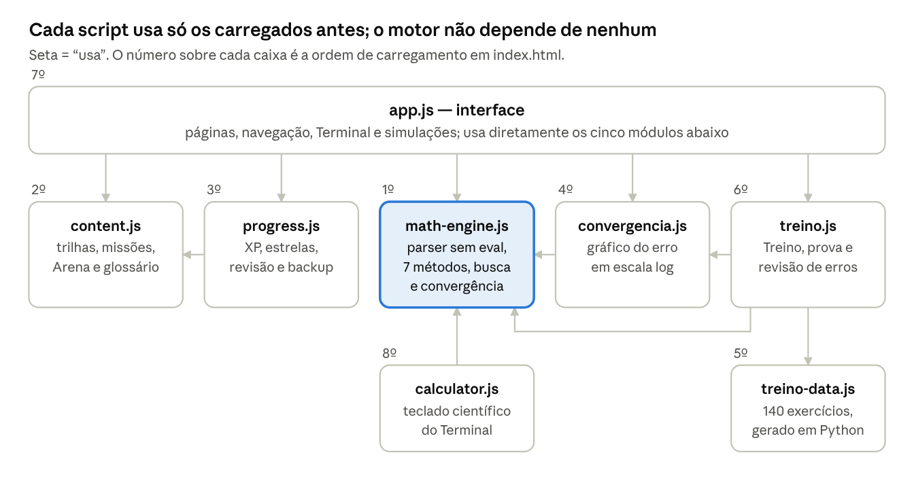
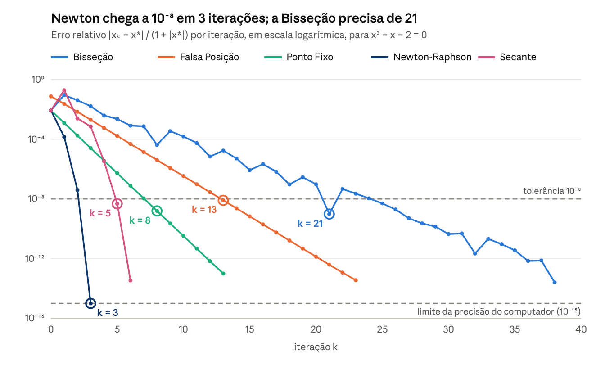

# Relatório técnico — Numera Academy

> Laboratório interativo de métodos numéricos · versão 9. Os números deste relatório vêm da última execução das suítes de teste (ver Apêndice A).

Rio de Janeiro, 17 de outubro de 2026

A Numera Academy (versão 9) é um laboratório web interativo para aprender sete métodos numéricos de Modelagem Computacional. Sua correção é sustentada por 1.505 verificações automáticas, 140 gabaritos calculados de forma independente e auditoria de acessibilidade sem violações.

**Autor:** Cauã De Angelis · Engenharia de Computação, UVA · Modelagem Computacional

## Resumo

Este relatório apresenta a Numera Academy, um site educativo que ensina sete métodos numéricos da disciplina de Modelagem Computacional: Bisseção, Falsa Posição, Ponto Fixo, Newton-Raphson, Secante, Eliminação de Gauss e Gauss-Seidel. O projeto reúne trilhas de aprendizado, missões de modelagem, desafios, um Treino de diagnóstico com 140 exercícios, modo prova e um Terminal que resolve equações e sistemas lineares mostrando cada passo e o gráfico de convergência.

A implementação é um site estático em JavaScript, sem dependências em tempo de execução, com interpretador de expressões próprio (sem `eval`) e funcionamento offline. A validação combinou testes de propriedades do motor numérico, gabaritos calculados de forma independente com sympy e mpmath (50 dígitos), testes de interface em Chromium e WebKit, auditoria de acessibilidade WCAG 2.1 AA e integração contínua.

As 1.505 verificações automáticas passam, os 140 gabaritos coincidem com o motor do site e a auditoria não encontrou violações em 25 telas. Em x³ − x − 2 = 0, as ordens de convergência observadas (Bisseção 0,99; Newton 2,01; Secante 1,44) são compatíveis com a teoria. A eficácia educativa ainda não foi avaliada com alunos.

**Palavras-chave:** métodos numéricos; zeros de funções; sistemas lineares; jogo educativo; validação de software.

## 1 Introdução

Métodos numéricos aproximam soluções que não têm fórmula fechada ou cuja fórmula é impraticável: a taxa de juros de um financiamento, a posição de um cometa na órbita, as temperaturas de uma placa. Na disciplina, o aluno precisa de três habilidades distintas: reconhecer quando cada método se aplica, executar as iterações e interpretar o resultado no problema real.

Exercícios tradicionais costumam informar o método no enunciado (“faça três iterações de Newton”), o que treina a execução, mas não a escolha. Calculadoras online fazem o oposto: entregam a resposta sem mostrar o caminho nem as condições de validade.

A Numera Academy foi construída para cobrir as três habilidades no mesmo ambiente. A versão 9, objeto deste relatório, acrescentou a Falsa Posição e o Ponto Fixo aos cinco métodos anteriores, além do gráfico de convergência, do modo prova, das dicas por erro típico e da infraestrutura de testes automáticos, publicação e funcionamento offline.

## 2 Objetivos

**Objetivo geral:** desenvolver um ambiente web interativo que ensine a escolher, executar e interpretar métodos numéricos para zeros de funções e sistemas lineares, com resultados matematicamente verificados.

**Objetivos específicos:**

1. Implementar os sete métodos em um motor numérico próprio, com critérios de parada e mensagens de falha explícitos.
2. Interpretar expressões matemáticas digitadas pelo usuário sem executar código arbitrário (sem `eval`).
3. Oferecer prática em quatro níveis: lição guiada, simulação passo a passo, exercícios com feedback e problemas aplicados.
4. Treinar o diagnóstico do método com 140 exercícios misturados, cujo enunciado não revela o método antes da escolha.
5. Mostrar a convergência de forma visual, com o erro por iteração e a ordem observada de cada método.
6. Validar o motor e os gabaritos contra uma referência independente, com testes automatizados repetíveis.
7. Garantir acessibilidade (WCAG 2.1 AA), compatibilidade com os principais navegadores e uso offline.

## 3 Fundamentação teórica

Os sete métodos dividem-se em cinco para zeros de funções reais, f(x) = 0, e dois para sistemas lineares, Ax = b. A velocidade de um método iterativo é medida pela ordem de convergência p: com erro eₖ = |xₖ − x\*|, vale aproximadamente a relação abaixo, com C constante.

```math
e_{k+1} \approx C \, e_k^{\,p}
```

### 3.1 Zeros de funções

**Bisseção.** Se f é contínua em \[a, b\] e f(a)·f(b) < 0, o Teorema do Valor Intermediário garante uma raiz no intervalo. Toma-se o ponto médio e mantém-se a metade que preserva a troca de sinal. O erro cai pela metade a cada passo (ordem 1, fator 1/2), o que permite saber de antemão quantas iterações bastam para uma tolerância ε.

```math
x_k = \frac{a_k + b_k}{2}, \qquad n \ge \log_2 \frac{b - a}{\varepsilon}
```

**Falsa Posição (regula falsi).** Exige as mesmas condições da Bisseção, mas corta o intervalo onde a corda entre (a, f(a)) e (b, f(b)) cruza o eixo. Em curvas quase retas, gasta muito menos avaliações. Em curvas convexas ou côncavas, uma das pontas fica parada e a convergência é linear, às vezes lenta.

```math
x_k = \frac{a_k f(b_k) - b_k f(a_k)}{f(b_k) - f(a_k)}
```

**Ponto Fixo.** Reescreve-se f(x) = 0 como x = g(x) e itera-se a partir de um chute x₀. Se |g′(x)| ≤ L < 1 perto da raiz (g é uma contração), a sequência converge linearmente com fator aproximado |g′(x\*)|. Com g′ negativa os valores oscilam em volta da raiz; com |g′| > 1 a reescrita diverge.

```math
x_{k+1} = g(x_k), \qquad |g'(x^*)| < 1
```

**Newton-Raphson.** Segue a tangente até o eixo. Para raiz simples e chute suficientemente próximo, a convergência é quadrática: as casas corretas quase dobram a cada passo. Falha ou se desvia quando f′(xₖ) ≈ 0. É um caso particular do Ponto Fixo, com g′(x\*) = 0.

```math
x_{k+1} = x_k - \frac{f(x_k)}{f'(x_k)}
```

**Secante.** Troca a derivada pela inclinação entre as duas últimas aproximações. Precisa de dois pontos iniciais, que não precisam cercar a raiz, e não usa derivada. A ordem é a razão áurea, (1 + √5)/2 ≈ 1,618.

```math
x_{k+1} = x_k - f(x_k)\,\frac{x_k - x_{k-1}}{f(x_k) - f(x_{k-1})}
```

### 3.2 Sistemas lineares

**Eliminação de Gauss com pivoteamento parcial.** Método direto: zera os coeficientes abaixo da diagonal, escolhendo em cada coluna o maior pivô em módulo, e resolve o sistema triangular por retrossubstituição. Custa cerca de 2n³/3 operações e dá a solução em um número fixo de passos.

**Gauss-Seidel.** Método iterativo que atualiza cada incógnita usando os valores já calculados na mesma rodada. A dominância diagonal estrita de A é condição suficiente de convergência. Cada iteração custa cerca de 2n² operações, vantajoso em sistemas grandes ou esparsos.

```math
x_i^{(k+1)} = \frac{1}{a_{ii}} \Big( b_i - \sum_{j<i} a_{ij} x_j^{(k+1)} - \sum_{j>i} a_{ij} x_j^{(k)} \Big)
```

### 3.3 Quadro comparativo

| Método | Dados iniciais | Condição principal | Critério de parada no site | Ordem |
| --- | --- | --- | --- | --- |
| Bisseção | \[a, b\] | f contínua e f(a)·f(b) < 0 | \|f(x)\| ≤ tol | 1 (fator 1/2) |
| Falsa Posição | \[a, b\] | f contínua e f(a)·f(b) < 0 | \|f(x)\| ≤ tol | 1 |
| Ponto Fixo | x₀ e g | \|g′\| < 1 perto da raiz | \|x − g(x)\| ≤ tol | 1 (fator ≈ \|g′(x\*)\|) |
| Newton-Raphson | x₀ | f′ ≠ 0 e chute próximo | \|f(x)\| ≤ tol | 2 |
| Secante | x₀ e x₁ | f(x₀) ≠ f(x₁) | \|f(x)\| ≤ tol | ≈ 1,618 |
| Eliminação de Gauss | A e b | A não singular | direto (número fixo de passos) | — |
| Gauss-Seidel | A, b e x⁽⁰⁾ | dominância diagonal estrita (suficiente) | resíduo normalizado e variação ≤ tol | 1 |

## 4 Metodologia

O trabalho seguiu ciclos de versão (v5 a v9): implementar, testar contra uma referência independente, revisar o conteúdo e só então discutir melhorias. Esta seção descreve a arquitetura, o motor numérico, o desenho pedagógico, a geração do gabarito e as ferramentas.

### 4.1 Arquitetura

O site é estático: HTML, CSS e JavaScript puros, sem etapa de compilação, sem servidor e sem bibliotecas em tempo de execução. Oito scripts são carregados em ordem fixa, e cada um expõe um objeto global usado pelos seguintes.



*Figura 1 — Arquitetura do site: 8 scripts em `dist/`, dependências conferidas no código.*

Como o motor (destacado) não depende de nenhum outro script nem da página, ele é testado no Node sem navegador, e o mesmo arquivo serve ao Terminal, às simulações e ao Treino.

A interface usa delegação de cliques (atributo `data-act`), um objeto de estado único e uma função `render()` que redesenha a página. O progresso fica no `localStorage` do navegador; nada é enviado a servidor. Um service worker guarda os 20 arquivos do site para uso offline, e a versão do cache é um resumo SHA-256 do conteúdo, então qualquer mudança invalida o cache antigo.

### 4.2 Motor numérico

- **Interpretador de expressões:** tokenização, árvore sintática e avaliação própria, sem `eval`. Aceita multiplicação implícita (2x), vírgula decimal e nomes em português (sen, tg).
- **Métodos:** cada execução devolve a tabela de iterações, o critério que a encerrou e observações (ponta parada na Falsa Posição, estimativa de |g′| no Ponto Fixo, tangente quase horizontal no Newton). Falhas param com mensagem, nunca com um número enganoso.
- **Busca automática:** 801 amostras em \[−40, 40\], refino em 64 partes perto de mínimos de |f| e até 400 candidatas. Bisseção, Falsa Posição, Newton e Secante são comparados, e vence a execução aceita com menos avaliações de f.
- **Convergência:** todos os métodos partem dos mesmos dados. O erro é medido contra uma raiz de referência polida por Newton, e a ordem observada é a inclinação da reta de mínimos quadrados de ln eₖ₊₁ contra ln eₖ.

### 4.3 Desenho pedagógico

| Componente | Função | Tamanho |
| --- | --- | --- |
| Trilhas | lição guiada (6 telas), simulação passo a passo e prática em três níveis | 7 métodos × 12 etapas = 84 |
| Missões | problema aplicado em três etapas: formular, calcular, interpretar | 7 |
| Arena | desafios rápidos com vidas e sequência | 42 |
| Treino | diagnosticar o método, resolver e conferir no gabarito | 140 exercícios, 53 áreas, 369 erros típicos |
| Modo prova | sorteio, cronômetro, nota (0,4 pelo método e 0,6 pela resposta) e relatório em PDF | 5, 10 ou 15 questões |
| Revisão | revisão espaçada dos diagnósticos errados | intervalos de 1, 3, 7 e 14 dias |
| Terminal | resolve equações e sistemas com passos, convergência, verificação e modo guiado | sistemas de 2 a 6 incógnitas |

Duas escolhas têm base na literatura de aprendizagem. No Treino, os métodos vêm misturados e o enunciado só revela o método depois da escolha, porque praticar problemas embaralhados treina a discriminação entre procedimentos (ROHRER; TAYLOR, 2007). A revisão em intervalos crescentes segue o efeito da prática distribuída (CEPEDA et al., 2006).

### 4.4 Gabarito independente

Os 140 exercícios são produzidos por um gerador em Python que usa sympy (derivadas exatas e frações) e mpmath com 50 dígitos, ou seja, uma implementação diferente da do site. Cada exercício traz o enunciado com e sem o nome do método, a resposta com tolerância, os dados do gráfico de convergência e os erros típicos, calculados simulando o engano: uma iteração a menos, a metade errada do intervalo, calculadora em graus, Jacobi no lugar de Gauss-Seidel.

O motor do site refaz depois as 140 contas e confere que nenhum erro típico é aceito como resposta certa. O gerador é reproduzível byte a byte, e a ordem dos exercícios usa semente fixa, sem dois métodos iguais seguidos.

### 4.5 Ferramentas

| Ferramenta | Uso |
| --- | --- |
| JavaScript (ES2021), HTML e CSS | o site |
| Node.js | verificações do motor, do conteúdo e da interface em DOM simulado |
| Python 3, sympy e mpmath | gerador e gabarito do Treino |
| Playwright 1.48 (Chromium 141) | fluxos completos, celular, modo escuro, offline e impressão |
| axe-core 4.10 | auditoria de acessibilidade WCAG 2.1 AA |
| WebKitGTK 2.52 e Selenium | motor do Safari |
| acorn 8.14 | análise estática de compatibilidade com Safari 15, Firefox 90 e Chrome 90 |
| GitHub Actions | testes a cada envio e publicação no GitHub Pages |

## 5 Validação e resultados

Todas as suítes passam na versão 9: 1.505 de 1.505 verificações, 0 divergências entre o gabarito independente e o motor e 0 violações de acessibilidade. As mesmas suítes rodam no GitHub Actions a cada envio, e o site só é publicado se todas passarem.

### 5.1 Testes automatizados

| Suíte | O que confere | Resultado |
| --- | --- | --- |
| Verificações gerais (Node) | interpretador, propriedades dos 7 métodos, entradas inválidas, busca automática, sistemas em escalas de 10⁻²⁰ a 10¹⁵, convergência, conteúdo, progresso, interface em DOM simulado, Treino, prova, revisão e PWA | 1.505 / 1.505 |
| Gabarito do Treino | as 140 respostas (sympy/mpmath) refeitas pelo motor; nenhum dos 369 erros típicos aceito; 140 gráficos | 0 divergências |
| Gerador reproduzível | o arquivo publicado é idêntico ao que o gerador produz | idêntico |
| Terminal no navegador | 100 equações digitadas tecla por tecla e 19 cenários do teclado científico | 100 / 100 e 19 / 19 |
| Terminal no motor | 1.000 polinômios e 400 equações transcendentes aleatórias | 1.000 / 1.000 e 398 / 400 (2 erros da referência, explicados) |
| Fluxos completos (Chromium) | trilhas, missões, Terminal, Treino, prova, impressão, só teclado, celular e modo escuro | 41 / 41 |
| Offline (PWA) | service worker, 20 arquivos em cache e cálculo sem internet | 10 / 10 |
| Acessibilidade (axe-core) | regras WCAG 2.0/2.1 A e AA em 25 telas, temas claro e escuro | 0 violações |
| Motor do Safari (WebKit) | scripts, páginas, teclado científico, convergência, Treino e prova | 21 / 21 |
| Compatibilidade (acorn) | código ES2021 sem recursos ausentes em Safari 15, Firefox 90 e Chrome 90 | 99 / 99 |

### 5.2 Convergência observada

O caso de referência é x³ − x − 2 = 0, com raiz x\* ≈ 1,5213797068. Todos os métodos partem dos mesmos dados: intervalo \[1; 2\], x₀ = 1,5, x₁ = 2 e, no Ponto Fixo, g(x) = ∛(x + 2). A ordem observada concorda com a teoria: cerca de 1 nos três métodos lineares, 2,01 no Newton e 1,44 na Secante, que com apenas três pontos úteis fica abaixo do valor teórico de 1,618.



*Figura 2 — Erro relativo por iteração, calculado pelo motor do site (v9): intervalo [1; 2], x₀ = 1,5, x₁ = 2 e g(x) = ∛(x + 2).*

Os métodos de ordem 1 descem em reta, com inclinação dada pelo fator de redução; Newton e Secante descem cada vez mais rápido. O círculo marca a primeira iteração com erro abaixo de 10⁻⁸.

| Método | Ordem teórica | Ordem observada | Fator teórico | Fator observado |
| --- | --- | --- | --- | --- |
| Newton-Raphson | 2 | 2,01 | — | — |
| Secante | ≈ 1,618 | 1,44 | — | — |
| Ponto Fixo | 1 | 1,00 | \|g′(x\*)\| = 1/(3x\*²) ≈ 0,144 | 0,14 |
| Falsa Posição | 1 | 1,00 | 1 − f′(x\*)(b − x\*)/f(b) ≈ 0,289 | 0,29 |
| Bisseção | 1 | 0,99 | 1/2 (cota do erro) | 0,53 |

Os fatores teóricos usam x\* ≈ 1,5214. Na Falsa Posição, a ponta b = 2 fica parada porque f é convexa em \[1; 2\]. Na Bisseção, 1/2 é o fator da cota (b − a)/2ᵏ; o erro em si oscila, porque o ponto médio pode passar perto da raiz por acaso, como em k = 21, e depois se afastar.

Na comparação de custo do Terminal, com tolerância 10⁻⁶, vence a Secante: 6 avaliações de f, contra 7 do Newton (que gasta duas avaliações extras por derivada), 15 da Falsa Posição e 24 da Bisseção.

Em sistemas, no exemplo diagonalmente dominante 10x − y + 2z = 6, −x + 11y − z = 25, 2x − y + 10z = −11, o Gauss-Seidel chega ao erro relativo 10⁻⁸ em 6 iterações, e o Jacobi, mostrado só como referência, em 13.

### 5.3 Acessibilidade e navegadores

A auditoria encontrou 32 falhas no início da v9, todas corrigidas: contraste do texto secundário (de 2,8:1 para 4,5:1), estado de foco do botão Resolver, transparência nas etapas bloqueadas e rótulos ARIA sem papel. O gráfico de convergência é operado pelo teclado e tem tabela com os números, para que a cor nunca carregue a informação sozinha.

O site foi executado de fato no Chromium 141 e no WebKitGTK 2.52, o mesmo motor do Safari. O Firefox foi verificado apenas por análise estática, porque não pôde ser instalado no ambiente de testes.

## 6 Limitações

O site fornece aproximações verificadas por critérios declarados, dentro de um escopo restrito; ele não prova existência nem unicidade de raízes para funções gerais.

- **Escopo:** raízes reais de equações de uma variável e sistemas lineares quadrados de 2 a 6 incógnitas. Não há EDOs, integração, interpolação, raízes complexas nem álgebra simbólica.
- **Busca automática amostrada:** não encontrar uma raiz não prova que ela não existe. Raízes mais próximas que cerca de 0,003, oscilações mais rápidas que a amostragem e escalas extremas podem escapar.
- **Resíduo não é erro:** resíduo pequeno pode coexistir com erro maior em x, em raízes múltiplas e em matrizes mal condicionadas.
- **Escolhas de implementação:** o Newton usa derivada por diferenças centrais, não simbólica; a Falsa Posição é a clássica, sem a modificação de Illinois; no Ponto Fixo, a função g é escolhida pelo usuário e o método não entra na comparação automática.
- **Ordem observada:** com poucos pontos úteis, como no Newton e na Secante, é uma estimativa.
- **Navegadores:** o Firefox não foi executado, só analisado estaticamente; o Safari foi representado pelo WebKitGTK, não pelo Safari do macOS ou do iOS.
- **Acessibilidade:** a auditoria é automática; não houve testes com pessoas usando leitores de tela.
- **Eficácia educativa:** não foi medida com alunos. Os testes comprovam a correção do software e do conteúdo, não o ganho de aprendizagem.
- **Dados locais:** o progresso fica em um único navegador, sem sincronização entre dispositivos; o backup em JSON é manual.

## 7 Conclusão e trabalhos futuros

Os objetivos foram atingidos no plano do software: os sete métodos estão implementados com critérios explícitos, o Treino exercita a escolha do método antes da execução, o gráfico de convergência torna visível a diferença entre ordem 1 e ordem 2, e a correção foi conferida contra uma referência independente em todas as 140 respostas. O site é acessível pelo critério WCAG 2.1 AA automatizado, funciona offline e está pronto para publicação com testes contínuos.

A principal lacuna é a evidência de aprendizagem. Os próximos passos, em ordem de prioridade:

1. Avaliar com uma turma da disciplina: pré-teste e pós-teste de diagnóstico de método e um questionário de usabilidade.
2. Publicar no GitHub Pages e recolher relatos de uso.
3. Testar no Firefox e no Safari reais e com leitores de tela (NVDA e VoiceOver).
4. Acrescentar a Falsa Posição modificada (Illinois), o Jacobi como método completo e a derivada simbólica no Newton.
5. Estender o conteúdo a outros temas da disciplina, como interpolação, integração numérica e EDOs (Euler e Runge-Kutta).

## Referências

BARRETT, R. et al. **Templates for the solution of linear systems:** building blocks for iterative methods. Philadelphia: SIAM, 1994. Disponível em: <https://www.netlib.org/linalg/html_templates/Templates.html>.

BURDEN, R. L.; FAIRES, J. D.; BURDEN, A. M. **Análise numérica**. Tradução da 10. ed. norte-americana. São Paulo: Cengage Learning, 2016.

CEPEDA, N. J. et al. Distributed practice in verbal recall tasks: a review and quantitative synthesis. **Psychological Bulletin**, v. 132, n. 3, p. 354–380, 2006. DOI: [10.1037/0033-2909.132.3.354](https://pubmed.ncbi.nlm.nih.gov/16719566/).

CHAPRA, S. C.; CANALE, R. P. **Métodos numéricos para engenharia**. 7. ed. Porto Alegre: AMGH, 2016.

DRISCOLL, T. A.; BRAUN, R. J. **Fundamentals of numerical computation**. Philadelphia: SIAM, 2017. Disponível em: <https://fncbook.com>.

ROHRER, D.; TAYLOR, K. The shuffling of mathematics practice problems boosts learning. **Instructional Science**, v. 35, n. 6, p. 481–498, 2007. DOI: [10.1007/s11251-007-9015-8](https://digitalcommons.usf.edu/psy_facpub/1767/).

RUGGIERO, M. A. G.; LOPES, V. L. R. **Cálculo numérico:** aspectos teóricos e computacionais. 2. ed. São Paulo: Makron Books, 1996.

W3C. **Web Content Accessibility Guidelines (WCAG) 2.1**. 2018. Disponível em: <https://www.w3.org/TR/WCAG21/>.

## Apêndice A — Como reproduzir os testes

Na pasta do projeto, com Node.js 18 ou mais novo e Python 3 com sympy e mpmath:

```bash
npm run testar                       # 1.505 verificações, gabarito do Treino e cache offline
python3 tests/treino/gerar-treino.py /tmp/t.js && cmp /tmp/t.js dist/treino-data.js
npm run servir                       # em outro terminal: site em http://127.0.0.1:8000
(cd tests/e2e && npm install)        # uma vez: Playwright, axe-core e acorn
npm run testar-navegador             # compatibilidade, fluxos, offline e acessibilidade
xvfb-run -a python3 tests/e2e/testar-webkit.py http://127.0.0.1:8000/   # motor do Safari (Linux)
```

O procedimento completo dos testes do Terminal está em `TESTES-TERMINAL.md`, e o de cada suíte, em `QUALIDADE.md`.
